# Optimization Algorithm for Sparrows with Merged Egret and Kocié Variation, Effective Takeoff! Improve the Sparrow, highly recommended!

Today, I bring you the Osprey-Cauchy-Sparrow Search Algorithm (OCSSA) algorithm, which combines the optimization of ospreys and Cauchy sparrows. This algorithm surpasses other excellent algorithms such as ants, sparrows, and subtraction optimizers directly in performance. Moreover, it does not increase the complexity of the algorithm. In the main loop, only one fitness function is called, making it suitable for complex engineering optimization. The execution time will not suddenly increase like some improved algorithms that incorporate backward learning and greedy strategies.
Based on the sparrow algorithm, the improvements are as follows:
① Logistic chaos mapping is used to initialize the diversity of the population.
② The global exploration strategy in the first stage of the osprey optimization algorithm replaces the original sparrow algorithm's explorer position update formula. The osprey optimization algorithm can compensate for the overly reliance of the sparrow algorithm on updating its position based on the previous generation's position. It randomly detects one food's location and attacks it. The update method for the explorer's position in the sparrow algorithm is updated based on the movement of the osprey towards fish. The global exploration strategy formula of the osprey optimization algorithm in the first stage is as follows:
③ The follower position update formula in the original sparrow algorithm is replaced by the Cauchy mutation strategy. The Cauchy distribution is similar to the standard normal distribution, a continuous probability distribution with values at the origin being small, and being relatively long and thin at both ends, approaching zero slowly. Therefore, compared to the normal distribution, it generates greater perturbations. Thus, using Cauchy mutation to perturb individual positions in the sparrow algorithm's position update expands the search scale of the sparrow algorithm, thereby enhancing the ability of the algorithm to escape local optima.
Tested on the CEC2005 benchmark set, the results are as follows: OCSSA is the improved algorithm proposed in this paper, SSA is the original sparrow optimization algorithm, DBO is the ant optimization algorithm, SABO is the subtraction average optimizer algorithm, and GTO is the artificial gorilla team optimization algorithm.
The iteration of the algorithm is 1000 times, with each particle set to 100.
CEC2005 test results
CEC2021 test results
Results Analysis: In the tests of single-peak and multi-peak functions, it is evident that the optimization performance of the sparrow algorithm with the integration of osprey and Cauchy mutation is truly outstanding!
Code Exhibition
clear\nclc\nclose all\ndim = 20; % Dimension, optional 10, 20\nnumber= 9;  % Function Name: 1 - 10\n[lower_bound,upper_bound,variables_no,fobj] = Get_Functions_cec2021(number,dim);\n% [lower_bound, upper_bound, variables_no, fobj] = CEC2005(number);  % [lb, ub, D, y]: lower bound, upper bound, dimension, objective function expression\npop_size=50;                      % population members \nmax_iter=1000;                  % maximum number of iteration\n%% OOA\n[DBO_Best_score,Best_pos,DBO_curve]=DBO(pop_size,max_iter,lower_bound,upper_bound,variables_no,fobj);  % Calculating the solution of the given problem using OOA \ndisplay(['The best optimal value of the objective funciton found by DBO  for ' [num2str(number)],'  is : ', num2str(DBO_Best_score)]);\n%% GTO\n[GTO_Best_score,~,GTO_curve]=GTO(pop_size,max_iter,lower_bound,upper_bound,variables_no,fobj);\ndisplay(['The best optimal value of the objective funciton found by GTO  for ' [num2str(number)],'  is : ', num2str(GTO_Best_score)]);\n%% SSA\n[SSA_Best_score,~,SSA_curve]=SSA(pop_size,max_iter,lower_bound,upper_bound,variables_no,fobj);\ndisplay(['The best optimal value of the objective funciton found by SSA  for ' [num2str(number)],'  is : ', num2str(SSA_Best_score)]);\n%% SABO\n[SABO_Best_score,~,SABO_curve]=SABO(pop_size,max_iter,lower_bound,upper_bound,variables_no,fobj);\ndisplay(['The best optimal value of the objective funciton found by SABO  for ' [num2str(number)],'  is : ', num2str(SABO_Best_score)]);\n%% OCSSA\n[OCSSA_Best_score,~,OCSSA_curve]=OCSSA(pop_size,max_iter,lower_bound,upper_bound,variables_no,fobj);\ndisplay(['The best optimal value of the objective funciton found by OCSSA  for ' [num2str(number)],'  is : ', num2str(OCSSA_Best_score)]);\n %% Figure\nfigure\nCNT=20;\nk=round(linspace(1,max_iter,CNT)); % Randomly select CNT points\n% Note: If the number of points drawn on the convergence curve is small, and the random points are sparse, it indicates that the number of points has been insufficient. At this time, the number of points should be increased gradually, such as 100, 200, 300, etc.\n% On the contrary, if the random points on the convergence curve are very dense, it indicates that too many points have been taken. At this time, the number of points should be reduced.\niter=1:1:max_iter;\n   semilogy(iter(k),SSA_curve(k),'k-o','linewidth',1);\n    hold on\n    semilogy(iter(k),DBO_curve(k),'b-^','linewidth',1);\n    hold on\n    semilogy(iter(k),SABO_curve(k),'r-x','linewidth',1);\n    hold on\n    semilogy(iter(k),GTO_curve(k),'m-*','linewidth',1);\n    hold on\n    semilogy(iter(k),OCSSA_curve(k),'g-p','linewidth',1);\ngrid on;\ntitle(['F',num2str(number),'Converging curve'])\nxlabel('Iteration count');\nylabel('Fitness value');\nbox on\nlegend('SSA','DBO','SABO','GTO','OCSSA')\nset (gcf,'position', [300,300,600,330]\n  

## Images

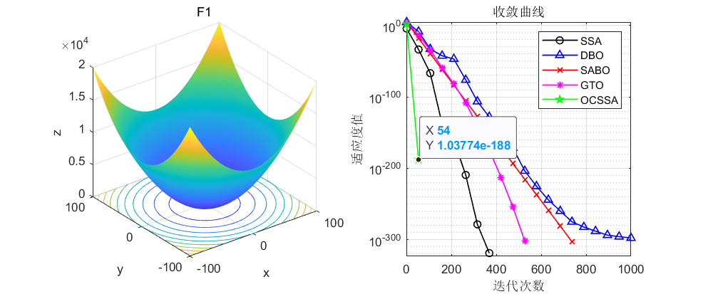
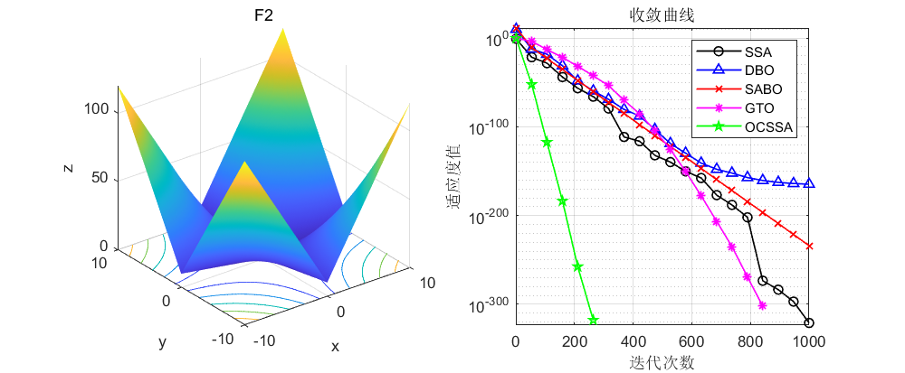
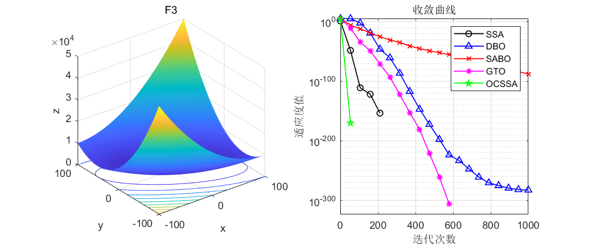
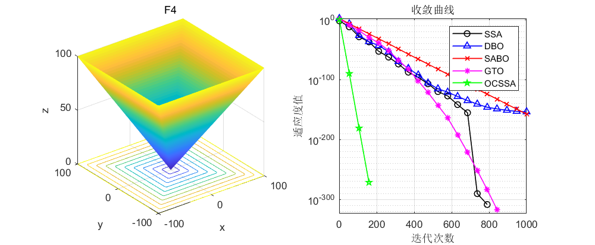
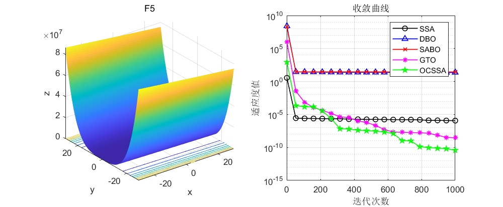
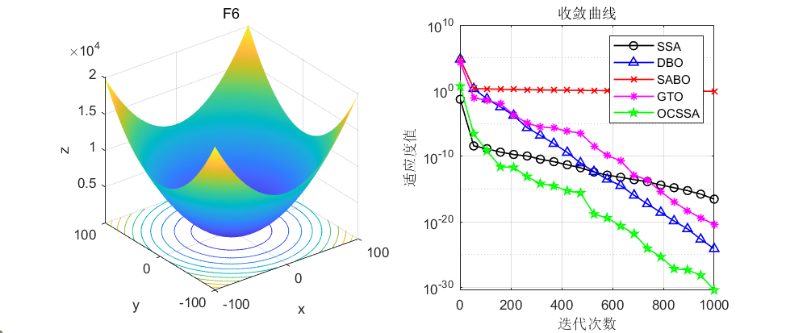
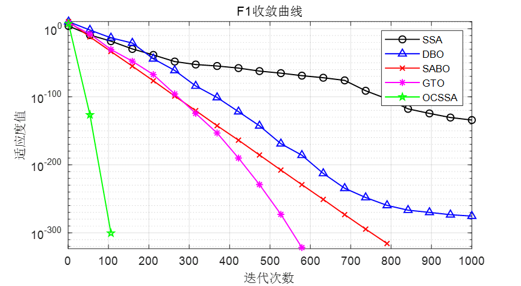
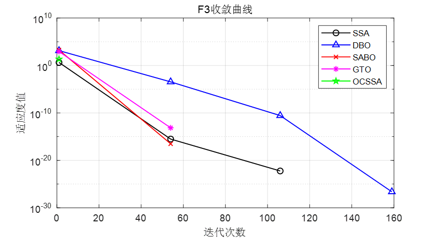
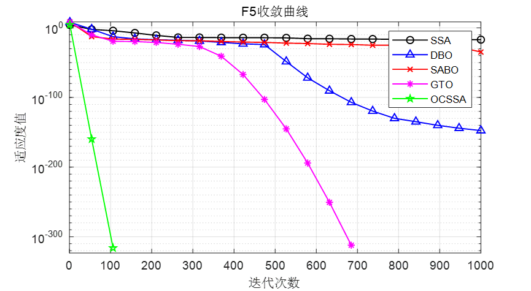
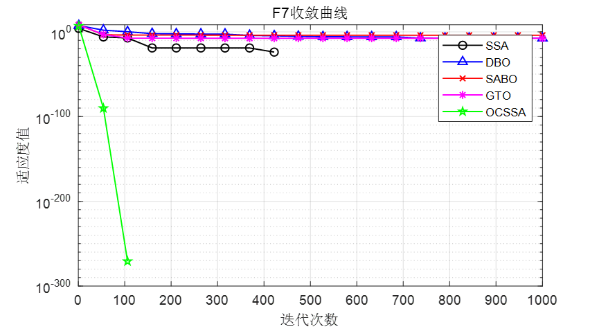
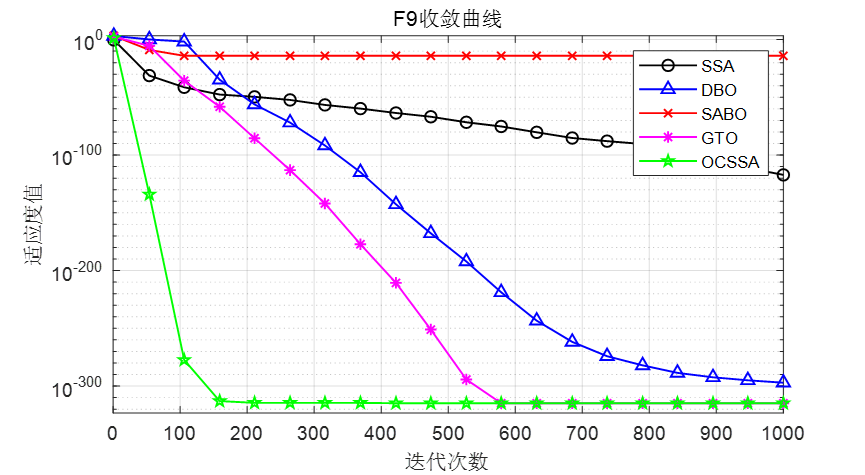

<!-- PAYMENT_BLOCK -->

## Get this dataset

- Payment link (Stripe): [Buy now](https://buy.stripe.com/3cs8yP7sY87d0vu9AB)
- Payment QR code: 

<!-- /PAYMENT_BLOCK -->
